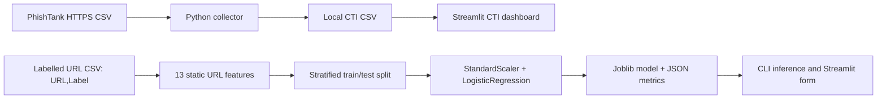

# Phishing Detection for SMEs — CTI, Machine Learning & DevSecOps

[](https://github.com/gaddah-yousef/detecteur-phishing-pme/actions/workflows/ci.yml)

A reproducible **educational phishing URL analysis project** for SMEs, combining threat-intelligence collection, lexical URL features, supervised classification, risk visualization and secure CI.

> **Scope:** this is a **research prototype**, not a production anti-phishing gateway. It never visits the URLs submitted for classification. A good score on the included synthetic demo dataset does **not** demonstrate accuracy on real phishing traffic.

## 1. Objectives

- Collect and summarize known phishing URL indicators from a public CTI feed.
- Extract explainable, static URL features without contacting target sites.
- Train and evaluate a baseline binary classifier on an **external labelled** dataset.
- Save a versioned local model artifact plus JSON metrics.
- Visualize CTI findings and classify sample URLs from a Streamlit interface.
- Enforce basic quality/security checks through GitHub Actions.

## 2. Architecture



**Important:** PhishTank's indicator feed is **not** automatically a labelled benign-versus-phishing training set. For supervised training, supply a dataset with both **legitimate and malicious** URLs and carefully review its provenance and license.

## 3. Repository structure

```text
.
├── .github/workflows/ci.yml           # Ruff, Pytest, Bandit, pip-audit, Gitleaks
├── jalon1/
│   └── telecharger_urls.py            # HTTPS feed collection / CSV normalization
├── jalon2/
│   ├── entrainer_modele.py            # Feature engineering, training, evaluation
│   ├── tester_modele.py               # Local prediction (never connects to URL)
│   ├── explorer_dataset.py            # Dataset exploration
│   ├── GUIDE_JALON2.md                # ML learning guide
│   └── tests/
│       ├── test_caracteristiques.py
│       └── test_training_pipeline.py
├── jalon3/
│   └── app.py                         # Streamlit dashboard and optional prediction
├── tests/fixtures/urls_demo.csv       # Synthetic demonstration labels only
├── requirements.txt
├── requirements-dev.txt
└── ROADMAP_DEVSECOPS.md
```

Outputs are saved under `jalon1/data/` and `jalon2/models/` locally and should not be committed if they contain live indicators or large datasets.

## 4. Installation

**Prerequisites:** Python 3.12+ (Python 3.13 is used by the current CI workflow), pip and an isolated virtual environment.

```bash
git clone https://github.com/gaddah-yousef/detecteur-phishing-pme.git
cd detecteur-phishing-pme
python -m venv .venv
# Linux/macOS: source .venv/bin/activate
# Windows PowerShell: .venv\Scripts\Activate.ps1
python -m pip install -r requirements.txt -r requirements-dev.txt
```

### Step A — Fetch threat-intelligence indicators (optional)

```bash
python jalon1/telecharger_urls.py
```

The collector requests a CSV through **HTTPS**, validates the expected columns, deduplicates URLs and stores a timestamped CSV. Availability depends on the upstream PhishTank service and its access conditions; if unavailable, the **model demo and static predictor still work offline**.

**Safety:** collected indicators may point to harmful websites. Never open them directly in a normal browser. The application only displays them.

### Step B — Train a reproducible model

For a purely **synthetic demonstration** (48 fabricated `.invalid` examples):

```bash
python -m jalon2.entrainer_modele --dataset tests/fixtures/urls_demo.csv
```

This creates:
- `jalon2/models/phishing_detector.joblib` — scaler, classifier, feature names and metrics;
- `jalon2/models/phishing_detector.metrics.json` — accuracy, precision, recall, F1, confusion matrix, class counts and split metadata.

For a **real evaluation**, provide your own labelled CSV:

```csv
URL,Label
https://example.com/guides,good
http://suspicious-url.example.invalid/verify,bad
```

The fragment above illustrates the **format only**, not a sufficient dataset.

```bash
python -m jalon2.entrainer_modele \
  --dataset jalon2/data/phishing_site_urls.csv \
  --test-size 0.25 --random-state 42
```

Accepted labels: `good`, `legitimate`, `legitime`, `0` for legitimate URLs and `bad`, `phishing`, `1` for phishing. The pipeline removes contradictory labels and duplicate URLs **before** splitting, to reduce exact-URL training/test leakage.

The model uses `StandardScaler + LogisticRegression(class_weight="balanced")`. **Metrics represent only the supplied evaluation split**; domain-level leakage, dataset bias and distribution shift still require further research.

### Step C — Analyze a URL locally

```bash
python -m jalon2.tester_modele "https://www.example.com/"
```

This reads the **locally trained model** and analyzes the URL string; it does not navigate to the site or send the URL to a third party.

**Warning:** Python `joblib.load` can execute arbitrary code from a malicious artifact. Only load files generated by trusted local training.

### Step D — Open the Streamlit dashboard

```bash
streamlit run jalon3/app.py
```

When a CTI CSV exists, the dashboard displays statistics and collected indicators. When a model exists, it also offers **static prediction**, an indicative probability and the features used. Both sections explain what is missing when no feed/model has been prepared.

## 5. Detection approach

The 13 lexical features include:
- URL length, domain length, punctuation and digits;
- estimated subdomain count;
- IP literal in the hostname;
- URL encoding, `@` symbol and repeated slash in the path;
- HTTPS usage indicator;
- a simple suspicious-keyword flag.

These are **heuristics**, not independent proof of phishing. Legitimate login pages can contain suspicious keywords and malicious pages can have valid TLS certificates.

## 6. Tests and CI

```bash
python -m pytest -v
ruff check .
bandit -r jalon1 jalon2 -x jalon2/tests
pip-audit
```

The repository contains feature-extraction unit tests and a new **end-to-end train → save → load → predict** test operating on synthetic data. The GitHub Actions pipeline also runs a Gitleaks scan.

No live third-party target is scanned by these tests. Check the GitHub Actions run before claiming all tests pass in your environment.

## 7. Limits, risks and roadmap

- Synthetic demo scores are **not** predictive of real-world effectiveness.
- Public phishing feeds can change format, access requirements and availability.
- Collected malicious URLs must not be automatically opened.
- The baseline model does not include HTML content, DNS, WHOIS or sandbox detonation.
- URL-level deduplication does not replace domain-disjoint evaluation, cross-validation or time-split evaluation.
- A classifier score is not a calibrated probability without an additional calibration analysis.
- This proof of concept has no production email gateway, automatic blocking or false-positive management.

**Next milestones:** benchmark an independently sourced dataset; evaluate precision/recall under class imbalance; add domain-based grouped splits; calibrate risk outputs; maintain a documented model card; add monitoring for concept drift and retraining controls.

## 8. Portfolio value

**Cyber Threat Intelligence · Python · Data Quality · Machine Learning Baselines · FastAPI-adjacent Security Engineering · Streamlit · DevSecOps · CI/CD · Explainable Features.**

**Author:** [Yousef Gaddah](https://github.com/gaddah-yousef) — responsible, authorized cybersecurity research.
