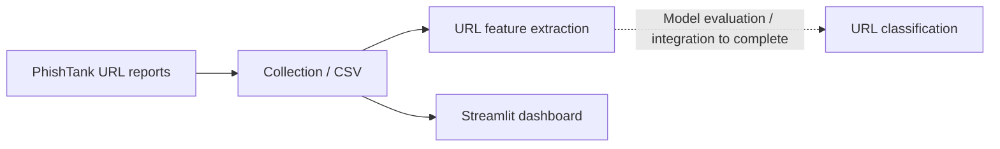

<div align="center">

# 🎣 Phishing URL Detection for SMEs
### Threat Intelligence · URL Feature Engineering · Python · Streamlit

[](https://github.com/gaddah-yousef/detecteur-phishing-pme/actions/workflows/ci.yml)


**A phased cybersecurity project for collecting phishing-URL intelligence and exploring URL-based detection methods.**

[Milestones](#-project-milestones) · [Run locally](#-run-locally) · [Limitations](#-current-status--limitations) · [Portfolio](https://github.com/gaddah-yousef/SOC-LAB/blob/main/docs/portfolio/github-projects.md)

</div>

---

## 🎯 Problem and approach

Small organizations need understandable ways to review suspicious links. This repository explores a pipeline from **reported phishing URLs** to **feature extraction** and a lightweight **analyst dashboard**.



The diagram separates the implemented educational components from **future modeling work**.

## 🗂️ Project milestones

| Area | Files | What they show |
| --- | --- | --- |
| **Jalon 1 — Threat data** | [Collection script](jalon1/telecharger_urls.py) · [Notes](jalon1/note_phishing.md) | URL intelligence ingestion and local dataset preparation |
| **Jalon 2 — URL analysis** | [Feature extractor](jalon2/entrainer_modele.py) · [Tests](jalon2/tests/) | Features such as length, IP-host check, suspicious tokens and subdomains |
| **Jalon 3 — Visualization** | [Streamlit app](jalon3/app.py) | Displays recently collected URLs and summary statistics |
| **Secure delivery** | [CI](.github/workflows/ci.yml) · [Roadmap](ROADMAP_DEVSECOPS.md) | Automated project checks and planned security improvements |

## 🧠 Example features

- URL and hostname length, punctuation and digit counts
- Number of subdomains and direct-IP host indicator
- Presence of suspicious words, `@`, or encoded characters
- HTTPS scheme indicator

These are **signals for analysis**, not evidence that a URL is malicious. In particular, HTTPS is not a guarantee of trust.

## 💻 Run locally

Create a virtual environment and install the dependencies listed in the repository:

```bash
python -m venv .venv
# Linux / macOS
source .venv/bin/activate
python -m pip install -r requirements.txt
```

Review [`jalon1/telecharger_urls.py`](jalon1/telecharger_urls.py) before collecting external intelligence; access to the data source may require additional configuration.

To explore a single URL with the implemented feature extractor:

```bash
python jalon2/entrainer_modele.py
```

The dashboard expects CSV files in `jalon1/data/`:

```bash
streamlit run jalon3/app.py
```

If no collected dataset is present, the dashboard shows an error explaining what it needs.

## ✅ Current status & limitations

- **Prototype:** feature extraction and a reporting dashboard are represented in the main branch.
- The filename `entrainer_modele.py` is historical; the current module primarily implements **feature extraction**.
- **No production-ready trained classifier, real-world precision/recall, or live URL verdict accuracy is claimed here.**
- Treat external URL intelligence as untrusted input. Avoid visiting or executing suspicious links.
- Review GitHub Actions outcomes before claiming CI is green.

## 👤 Author & related projects

**Yousef Gaddah** — Cybersecurity & Cloud Computing Engineering Student, ENIM – Mines Rabat.

[GitHub](https://github.com/gaddah-yousef) · [Cyber Threat Intelligence (Sentinel PME)](https://github.com/gaddah-yousef/-PFA-Cyber-Threat-Intelligence) · [SOC-LAB](https://github.com/gaddah-yousef/SOC-LAB)
